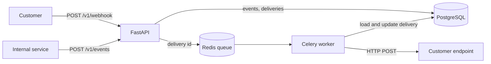
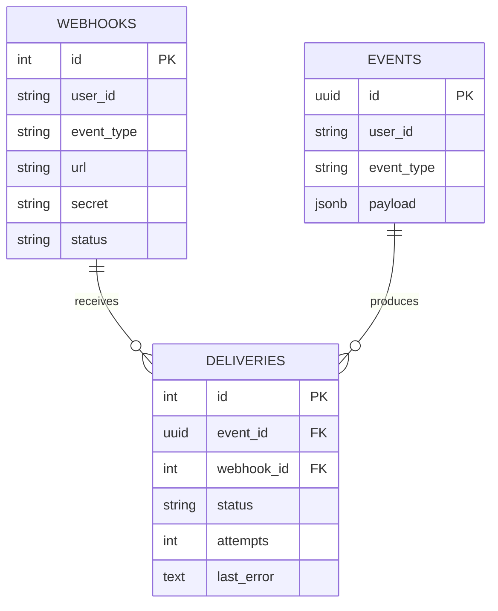

# Webhook Delivery Platform

A multi-tenant webhook platform built with **FastAPI**, **PostgreSQL**, **Celery** and **Redis**. Customers register HTTP endpoints for the event types they care about; internal services publish domain events (such as `invoice.paid`); the platform fans each event out to every matching endpoint and delivers it in the background, recording the outcome of every attempt.

It follows the same model as Stripe and GitHub webhooks, and is based on a system design exercise for a large-scale SaaS webhook service with at-least-once delivery.


## Features

- **Endpoint management**: register, read, update and delete endpoints, and activate or deactivate them without losing their configuration
- **Event fan-out**: one published event creates one delivery record per matching active endpoint, so each endpoint's delivery is tracked independently
- **Background delivery**: the publish API persists deliveries and returns `202 Accepted` immediately; Celery workers send the HTTP requests, so a slow customer endpoint never blocks the API
- **Durable task handling**: tasks are acknowledged only after they finish (`acks_late`), so a worker crash does not lose a delivery
- **Request validation**: Pydantic schemas reject invalid URLs and fields at the API boundary
- **Live console**: a dashboard that shows endpoints, deliveries, queue depth and what the customer endpoint received, updated every second
- **Fault injection**: a fake customer endpoint that can fail, return a chosen status code, or respond slowly, for testing delivery behaviour

## Roadmap

- [x] Endpoint CRUD API
- [x] Event publishing with subscriber fan-out
- [x] Background delivery with Celery and Redis
- [x] Live dashboard and fake customer endpoint
- [ ] Exponential backoff with jitter, scheduled retries for up to 3 days, and a dead letter queue
- [ ] HMAC-SHA256 payload signing
- [ ] Test suite with pytest and CI with GitHub Actions
- [ ] One-command startup with Docker Compose

## Architecture



When an event is published:

1. The API stores the event and looks up active endpoints by `(user_id, event_type)`, using a composite index.
2. It creates one `pending` delivery per endpoint and commits the event and its deliveries in a single transaction.
3. Only after the commit, it enqueues each delivery ID to Redis and returns `202 Accepted`.
4. A Celery worker picks up the ID, loads the latest state from PostgreSQL, sends the webhook with a 5 second timeout, and records the result.

## Tech stack

| Area | Tools |
| --- | --- |
| API | Python 3.11, FastAPI, Pydantic, Uvicorn |
| Database | PostgreSQL 16, SQLAlchemy 2.0 |
| Queue and workers | Redis 7, Celery |
| HTTP client | httpx |
| Local infrastructure | Docker |

## Project structure

```
webhook-platform/
├── app/
│   ├── main.py            # FastAPI app and router registration
│   ├── database.py        # Database engine and session dependency
│   ├── models.py          # SQLAlchemy models: webhooks, events, deliveries
│   ├── schemas.py         # Pydantic request and response schemas
│   ├── api/
│   │   ├── webhooks.py    # Endpoint management API
│   │   ├── events.py      # Event publishing and fan-out
│   │   └── dashboard.py   # Console page and its data endpoint
│   ├── worker/
│   │   ├── celery_app.py  # Celery configuration
│   │   ├── tasks.py       # Delivery task
│   │   └── delivery.py    # Builds the payload and sends the HTTP request
│   └── static/
│       └── index.html     # Webhook Console
├── tools/
│   └── receiver.py        # Fake customer endpoint with fault injection
└── requirements.txt
```

## Data model



Events and deliveries are stored separately so that one event sent to several endpoints can succeed for one endpoint and fail for another, with each delivery tracked and retried on its own.

## API

| Method | Path | Description |
| --- | --- | --- |
| `POST` | `/v1/webhook` | Register an endpoint. Returns the signing secret once. |
| `GET` | `/v1/webhook/{id}` | Get an endpoint |
| `PUT` | `/v1/webhook/{id}` | Update the URL or status (`active` / `inactive`) |
| `DELETE` | `/v1/webhook/{id}` | Delete an endpoint |
| `POST` | `/v1/events` | Publish an event. Returns `202 Accepted`. |

Interactive API docs are available at `http://127.0.0.1:8000/docs`.

Register an endpoint:

```bash
curl -X POST http://127.0.0.1:8000/v1/webhook \
  -H "Content-Type: application/json" \
  -d '{"user_id": "user_3", "event_type": "invoice.paid", "url": "http://localhost:9000/hooks"}'
```

Publish an event:

```bash
curl -X POST http://127.0.0.1:8000/v1/events \
  -H "Content-Type: application/json" \
  -d '{"user_id": "user_3", "event_type": "invoice.paid", "payload": {"invoice_id": "inv_001", "amount": 100}}'
```

The customer endpoint receives:

```json
{
  "id": "43478aae-...",
  "type": "invoice.paid",
  "created_at": "2026-10-17T07:31:43+00:00",
  "data": {"invoice_id": "inv_001", "amount": 100}
}
```

The `id` is unique per event, so receivers can deduplicate under at-least-once delivery.

## Getting started

### Prerequisites

- Python 3.11 or later
- Docker

### Setup

```bash
git clone https://github.com/Sunnylin0320/webhook-platform.git
cd webhook-platform
python3 -m venv .venv
source .venv/bin/activate
pip install -r requirements.txt
```

Start PostgreSQL and Redis:

```bash
docker run --name webhook-db \
  -e POSTGRES_USER=webhook \
  -e POSTGRES_PASSWORD=webhook \
  -e POSTGRES_DB=webhook \
  -p 5432:5432 \
  -v webhook-data:/var/lib/postgresql/data \
  -d postgres:16

docker run --name webhook-redis -p 6379:6379 -d redis:7
```

### Run

Run each service in its own terminal from the project root, with the virtual environment activated:

```bash
uvicorn app.main:app --reload                                        # API on port 8000
uvicorn tools.receiver:app --port 9000 --reload                      # Fake customer endpoint
celery -A app.worker.celery_app:celery_app worker --loglevel=info    # Delivery worker
```

Open the console at **http://127.0.0.1:8000**.

## Testing failure scenarios

The fake customer endpoint accepts query parameters, so each registered URL can behave differently:

| URL | Behaviour |
| --- | --- |
| `http://localhost:9000/hooks` | Always succeeds |
| `http://localhost:9000/hooks?fail_rate=0.5` | Fails about half the time with HTTP 500 |
| `http://localhost:9000/hooks?fail_rate=1&fail_status=400` | Always returns HTTP 400 |
| `http://localhost:9000/hooks?delay=3` | Responds after 3 seconds |

Things worth trying in the console:

- Register a `delay=3` endpoint and publish an event. The API still responds in milliseconds, while the delivery stays `pending` for about 3 seconds.
- Stop the Celery worker and publish a few events. The API keeps accepting them and tasks pile up in the Redis queue. Restart the worker and the backlog drains.
- Stop the fake customer endpoint and publish an event. The delivery is recorded as failed with a connection error.

